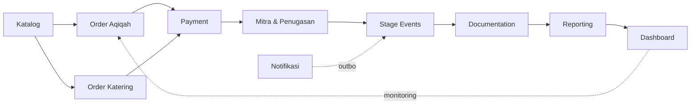

# 06 — MODULE BREAKDOWN

> **Sukses Aqiqah** — _"Tunaikan Ibadah, Tebarkan Manfaat"_
> Entity yang dirujuk mengikuti **05_DATABASE_DESIGN** (sumber kebenaran).

| Field   | Value                                                        |
| ------- | ------------------------------------------------------------ |
| Dokumen | 06_MODULE_BREAKDOWN                                          |
| Versi   | 2.1 — modul Katering & margin mitra                           |
| Tanggal | 2026-09-22                                                   |
| Status  | **Selaras dengan `features/` & 56 migration**                 |

> **Kenapa berubah.** v1.0 memecah pekerjaan lapangan jadi dua modul —
> *Slaughter* dan *Distribution* — yang berporos pada `slaughter_records` dan
> `distributions`. Kedua tabel itu dihapus 20 Agustus dan diganti
> `order_stage_events`, sebab tahapan lapangan **bercabang** menurut mode
> penyaluran dan dua tabel tetap tidak bisa mewakilinya.

---

## Peta Modul



> **Katering memasuki rantai yang sama sejak pembayaran.** Yang terpisah hanya
> pintu masuknya — form & RPC sendiri — sebab pesanan aqiqah melahirkan baris
> `animals` beserta segala yang mengalir darinya (jumlah ekor, data lahir anak,
> tahap penyembelihan, sertifikat), sementara katering tidak punya satu pun dari
> itu. Sesudah order terbentuk, keduanya ditangani modul yang persis sama.

Setiap modul: **Tujuan · Entity utama · Fungsi inti · Aktor · Aturan kunci**.

---

## 1. Katalog Paket

- **Tujuan:** Satu sumber untuk apa yang dijual — harga yang ditagih **dan** yang dipajang.
- **Entity:** `services`
- **Kode:** `features/services/`, `server/actions/services.ts`
- **Fungsi inti:** CRUD paket; isi paket (`meta`); konten halaman depan (tagline, fitur, foto); aktif/non-aktif.
- **Aktor:** superadmin
- **Aturan kunci:**
  - Halaman depan **membaca tabel ini** (sejak 3 September) — tidak ada lagi daftar kembar di `lib/constants/site.ts`.
  - `slug` dipakai sebagai tautan `?paket={slug}`; unik **hanya di antara paket hidup**.
  - Paket non-aktif tidak boleh dipasarkan (`services_landing_requires_active`).
  - Menghapus = soft delete; paket yang pernah dipesan tidak bisa dihapus.

### 1.1 Jenis layanan dan perannya

`service_type` memuat `aqiqah`, `qurban`, `sedekah_daging`, `nasi_box`,
**`katering`**, serta varian katering baru: **`katering_ayam`**, **`katering_daging`**, dan **`katering_kebuli`**. Layanan yang dipasarkan berperan
berbeda, dan perbedaannya menentukan ke mana tombolnya mengarah:

| Jenis                                                           | Satuan | Peran                        | Jalur pesan                 |
| --------------------------------------------------------------- | ------ | ---------------------------- | --------------------------- |
| `aqiqah`                                                        | ekor   | Pesanan utama                | `/checkout?paket=`          |
| `katering`, `katering_ayam`, `katering_daging`, `katering_kebuli`| box   | Pesanan **berdiri sendiri**  | `/checkout/katering?paket=` |
| `nasi_box`                                                      | box    | **Tambahan** atas aqiqah     | WhatsApp                    |

> **Nasi box sengaja tidak punya tombol "Pesan".** `create_guest_order` menolak
> layanan bertipe `nasi_box` sebagai paket utama — ia hanya bisa ikut sebagai
> tambahan di dalam pesanan aqiqah. Menawarkannya sebagai kartu bertombol pesan
> berarti menjanjikan sesuatu yang pasti ditolak di ujung alur, tanpa satu pun
> galat yang memperingatkan lebih dulu. Karena itu halaman depan merendernya
> sebagai blok ringkas, bukan kartu sejajar.

`qurban` dan `sedekah_daging` tetap ada di enum tetapi **tidak dipasarkan**:
checkout hanya melayani aqiqah, jadi memajangnya berarti menawarkan sesuatu yang
tidak bisa dipesan. Yang dicabut keputusan pemasarannya, bukan kemampuannya.

## 2. Order Management

- **Tujuan:** Siklus order dari masuk sampai selesai.
- **Entity:** `orders`, `order_items`, `participants`, `animals`, `order_counters`
- **Kode:** `features/orders/`, `features/checkout/`
- **Fungsi inti:** CRUD order; checkout tamu; nomor unik `IA-YYYYMM-####`; state machine; timeline audit.
- **Aktor:** admin, superadmin; pengunjung anonim lewat `create_guest_order`
- **Aturan kunci:**
  - **Tidak ada scope cabang** — yang menyekat data adalah `vendor_id`.
  - Order tamu (`created_by IS NULL`) tertahan di `new` sampai admin memverifikasi.
  - Harga, total, status, dan jumlah terbayar **tidak pernah datang dari klien**.

## 2b. Pemesanan Katering

- **Tujuan:** Melayani pesanan katering acara **tanpa aqiqah** — pengajian, rapat, syukuran.
- **Entity:** `orders`, `order_items`, `participants` (tidak melahirkan `animals`)
- **Kode:** `features/catering/`, `server/actions/catering.ts`, RPC `create_catering_order`
- **Aktor:** pengunjung anonim lewat `/checkout/katering`
- **Aturan kunci:**
  - **Rute & RPC terpisah dari aqiqah**, bukan cabang di dalamnya. Menyatukannya
    membuat tiap aturan jadi bersyarat di tiga lapis yang wajib sepakat selamanya
    (layar, zod, fungsi database) — dan begitu ketiganya berselisih, pemesan
    lolos seluruh isian lalu ditolak database.
  - **Selalu `kirim`.** Modenya ditetapkan RPC, tidak ditanyakan form. Efek
    sampingnya diinginkan: pembeli tetap bisa menekan "pesanan sudah saya
    terima" di halaman laporan.
  - **Boleh beberapa paket sekaligus** (mis. 50 box Sederhana + 30 box Lengkap);
    paket yang sama dua kali ditolak, gabungkan jumlahnya.
  - **Nol baris `animals`** — dan itu yang membuat tahapnya menyesuaikan diri
    tanpa satu baris pun diubah: cabang `sembelih` di `generate_stage_checklist`
    mengambil barisnya dari tabel hewan, jadi order tanpa hewan menghasilkan
    `persiapan → masak → kirim → terkirim`.
  - Batas: 10 jenis paket per pesanan, 5.000 box per baris, 10.000 box total.
  - Order tamu, jadi **tetap menunggu verifikasi admin** seperti aqiqah.

> **Bukti masak tidak wajib untuk katering** (keputusan pemilik usaha).
> Ditegakkan di `missing_doc_stages` pada `v_order_progress`, **bukan** dengan
> menurunkan `stage_requirements.min_docs` — tabel itu berlaku global per tahap,
> jadi menurunkannya akan ikut melepas gerbang bukti masak untuk seluruh order
> aqiqah yang sudah berjalan, tanpa satu pun galat. Lihat `05 §5`.

## 3. Payment Management

- **Tujuan:** Mencatat & memverifikasi uang masuk.
- **Entity:** `payments`, `orders.paid_amount`
- **Kode:** `features/payments/`
- **Aktor:** admin, superadmin — **vendor sepenuhnya di luar urusan uang**
- **Aturan kunci:**
  - `paid_amount` dihitung trigger `sync_order_payment`, bukan dikirim klien.
  - Bukti transfer diunggah langsung ke Storage; path diverifikasi ulang terhadap nomor order.
  - Gerbang pelunasan: order baru bergerak saat `payment_status = 'paid'`. Cicilan tidak diterima — `recordPayment` menuntut nominal persis sisa tagihan.

## 4. Mitra & Penugasan

- **Tujuan:** Master mitra pelaksana, modal per paket, dan penugasan ke order.
- **Entity:** `vendors`, `vendor_services`, `vendor_coverage`, `locations`, `orders.vendor_id`
- **Kode:** `features/vendors/`, `server/actions/vendors.ts`
- **Aktor:** superadmin (master & modal), admin (penugasan)
- **Aturan kunci:**
  - **Penugasan adalah pintu masuk data vendor** — sebelum ditugaskan, vendor tidak melihat order sama sekali.
  - Menugaskan mitra **menerbitkan daftar tahap** (`generate_stage_checklist`).
  - Penugasan juga **membekukan modal**: `vendor_services.vendor_price` disalin
    ke `order_items.vendor_unit_price` saat itu juga. Disalin, bukan dibaca
    lewat join — revisi kesepakatan bulan depan tidak boleh menggeser margin
    order yang sudah berjalan.
  - Paket yang belum punya modal untuk mitra itu dibiarkan **NULL**, bukan nol:
    nol berarti "modalnya memang nol" dan marginnya terbaca penuh.
  - Lokasi divalidasi **milik mitra order ini**.
  - **Katering memakai rantai yang sama** — mitra, modal per paket, penugasan,
    tahap, dan KPI. Yang membedakan hanya modenya yang selalu `kirim`, jadi
    mitra tanpa layanan `kirim` tidak ditawarkan untuknya.

> ⚠️ **Order yang ditugaskan sebelum 22 September bermargin terlalu besar.**
> `vendor_unit_price` tidak pernah diisi kode mana pun sampai tanggal itu —
> `assignVendor` hanya menulis `vendor_id`. Order lama tidak terbetulkan
> sendiri; nilainya tetap NULL sampai mitranya ditugaskan ulang. Lihat `09`.

## 5. Stage Events

- **Tujuan:** Mencatat pelaksanaan lapangan yang **bercabang** menurut mode penyaluran.
- **Entity:** `order_stage_events`, `stage_requirements`, `animals`
- **Kode:** `features/stages/`, `server/actions/stages.ts`
- **Aktor:** vendor (melapor), admin/superadmin (memvalidasi)
- **Aturan kunci:**

  ```
  salur : persiapan → sembelih → masak → salur
  kirim : persiapan → sembelih → masak → kirim → terkirim
  ```

  - Daftar tahap **terbit otomatis**; vendor tidak bisa mengarang tahap.
  - Urutan ditegakkan `enforce_stage_order` — lompat tahap ditolak **database**, bukan hanya UI.
  - Tahap `sembelih` terbit **satu baris per ekor**.
  - Pada tahap `kirim`, alamat pembeli **ditampilkan** ke vendor, tidak diketik ulang.
  - `fulfilment_sequence()` satu-satunya sumber percabangan; kembarannya di TypeScript dijaga tes yang membaca migration langsung.

## 6. Documentation Management

- **Tujuan:** Bukti pelaksanaan per tahap.
- **Entity:** `documentations`
- **Kode:** `features/documentation/`
- **Aktor:** vendor (unggah), admin/superadmin (validasi)
- **Aturan kunci:**
  - **Satu tingkat** validasi: `pending` → `approved`/`rejected`; tolak wajib beralasan.
  - **Pemisahan tugas** — pengunggah tidak bisa memvalidasi unggahannya sendiri.
  - Bukti yang dilampirkan ke tahap salah ditolak `enforce_documentation_stage_match`.
  - Gerbang kelengkapan dibaca dari `v_order_progress.missing_doc_stages`, bukan dihitung ulang di TypeScript.
  - Dokumentasi `approved` tidak dapat dihapus.

## 7. Reporting Management

- **Tujuan:** Laporan pelaksanaan untuk pemesan.
- **Entity:** `reports`, `orders.public_token`
- **Kode:** `features/reporting/`, `app/r/[token]`
- **Aktor:** admin, superadmin; pemesan (baca)
- **Aturan kunci:**
  - Laporan **bercerita per tahap**, disusun dari `order_stage_events` yang `validated`.
  - Hanya dokumentasi `approved` yang masuk; kontak peserta tidak pernah ikut.
  - Halaman publik lewat `get_public_report` — RPC mengunci bentuk keluaran di level database.
  - Generate ulang menambah versi **tanpa** mengubah `public_token`.

## 8. Notifikasi

- **Tujuan:** Outbox peristiwa yang perlu ditindaklanjuti.
- **Entity:** `notifications`
- **Kode:** `features/notifications/`
- **Aturan kunci:**
  - **Pemicunya trigger, bukan server action** — peristiwanya datang dari banyak jalan, dan yang lupa memanggil tidak menghasilkan galat.
  - Idempoten lewat `event_key` + indeks unik parsial.
  - ⚠️ **Worker pengirim belum ada** — pengiriman masih manual-klik.

## 9. Dashboard & Monitoring

- **Tujuan:** Menjawab litmus test < 10 detik.
- **Entity:** `v_open_orders`, `v_order_progress`, **`v_vendor_kpi`**
- **Kode:** `features/dashboard/`
- **Aturan kunci:**
  - KPI diukur **per mitra**, bukan per cabang — dengan satu tempat operasi, yang berguna adalah "mitra mana yang lambat, mana yang paling sering buktinya ditolak".
  - Agregat lintas mitra **ditimbang jumlah order**, bukan rata-rata polos.

---

## Matriks Modul × Entity

| Modul              | Entity utama                                          |
| ------------------ | ----------------------------------------------------- |
| Katalog            | `services`                                            |
| Order              | `orders`, `order_items`, `participants`, `animals`     |
| Katering           | `orders`, `order_items`, `participants` (tanpa `animals`) |
| Payment            | `payments`                                            |
| Mitra & Penugasan  | `vendors`, `vendor_services`, `vendor_coverage`, `locations` |
| Stage Events       | `order_stage_events`, `stage_requirements`             |
| Documentation      | `documentations`                                      |
| Reporting          | `reports`                                             |
| Notifikasi         | `notifications`                                       |
| Dashboard          | `v_open_orders`, `v_order_progress`, `v_vendor_kpi`    |
| (lintas)           | `profiles`, `schedules`, `issues`, `audit_logs`, `app_settings`, `regions` |

---

### Referensi silang

- Skema & entity → `05_DATABASE_DESIGN.md`
- Role & kewenangan → `07_USER_ROLES.md`
- Alur kerja → `08_WORKFLOW_MAP.md`
- Status terkini → `../TASKS.md`
